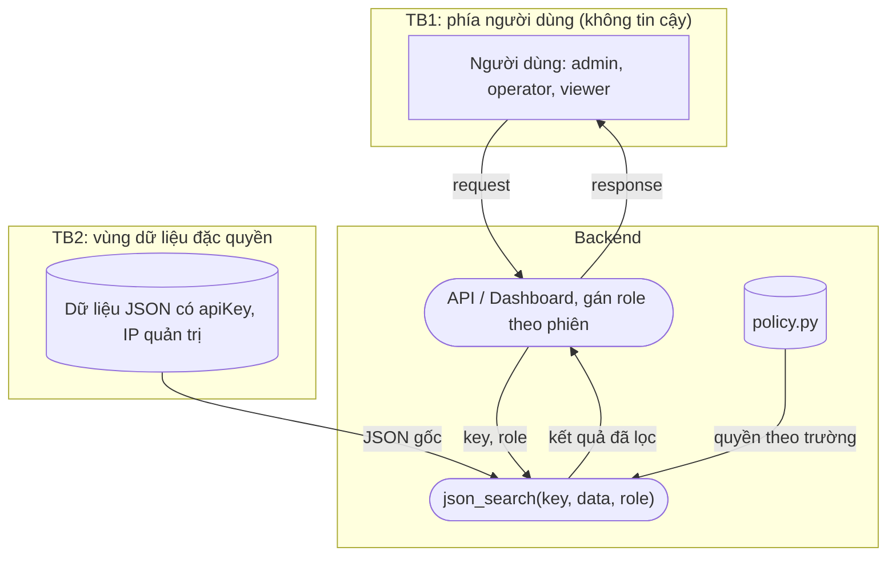

# Threat model cho json_search()

## 1. Phạm vi

- Hàm `json_search(key, input_object, role=None)` trong `unittest/recursive_json_search.py`.
- Dữ liệu: JSON về sự cố mạng trong `test_data.py` (lấy từ Cisco DNA Center), trong đó có khóa
  SNMP và IP quản trị của thiết bị.
- Hàm được backend của dashboard gọi thay cho 3 role: admin, operator, viewer.
- Giả định:
  - role do server gán theo phiên đăng nhập, không lấy từ request của client.
  - input_object là JSON đã parse, cấu trúc không tin cậy được.
  - `policy.py` là nơi duy nhất quy định quyền; trường không có trong `policy.py` coi là không
    nhạy cảm.
- Ngoài phạm vi: đăng nhập, TLS, lưu log (thuộc tầng API).

## 2. DFD

- TB1: giữa người dùng và backend. Những gì client gửi lên đều không tin cậy.
- TB2: giữa vùng dữ liệu đặc quyền và người dùng ít quyền. Dữ liệu muốn ra ngoài đều phải đi
  qua `json_search()`, nên hàm này phải kiểm tra role.

## 3. Role và mục đích gọi hàm

| Role | Dùng json_search() để | Được đọc |
|---|---|---|
| admin | quản trị thiết bị, xử lý lỗi SNMP | apiKey, managementIpAddress, issueSummary |
| operator | khoanh vùng sự cố, vào thiết bị qua IP quản trị | managementIpAddress, issueSummary |
| viewer | xem dashboard, làm báo cáo | issueSummary |
| thiếu role hoặc role lạ | thường là lỗi tích hợp hoặc request bị sửa | không đọc được gì |

Trường không có trong `policy.py` thì role hợp lệ nào cũng đọc được.

## 4. Asset

| Asset | Giá trị trong test_data.py | Vì sao cần bảo vệ |
|---|---|---|
| apiKey | SNMP-COMMUNITY-STRING-7f3a9c | community string SNMP, coi như mật khẩu của thiết bị |
| managementIpAddress | 10.10.20.21 | lộ IP quản trị thì dễ bị nhắm tấn công vào thiết bị |
| policy.py và dữ liệu gốc | | bị sửa thì quyền bị nới hoặc người khác thấy dữ liệu sai |
| tính sẵn sàng của hàm | | một JSON lạ không được làm sập request |

## 5. Mối đe dọa (STRIDE)

| ID | Loại | Mô tả | Biện pháp |
|---|---|---|---|
| T-01 | Information disclosure | viewer gọi `json_search("apiKey", data)` và nhận được khóa SNMP vì hàm không kiểm tra role | SR-01 |
| T-02 | Information disclosure | tìm theo khóa cha (`deviceDetails`) thì nhận nguyên khối dữ liệu, trong đó có apiKey và IP quản trị | SR-04 |
| T-03 | Elevation of privilege | role là None, "", "Admin" hay ["admin"] vẫn được coi như có quyền | SR-02 |
| T-04 | Spoofing | backend lấy role từ tham số client gửi lên (`?role=admin`) | SR-03 |
| T-05 | Tampering | code khác trong cùng tiến trình sửa POLICY lúc đang chạy để nới quyền | SR-06 |
| T-06 | Tampering | kết quả trả về trỏ thẳng vào dữ liệu gốc, caller sửa kết quả làm đổi dữ liệu dùng chung | SR-06 |
| T-07 | Denial of service | JSON lồng quá sâu gây RecursionError; mảng có null hoặc số thực gây TypeError | SR-05 |
| T-08 | Repudiation | không ghi lại các lần bị từ chối đọc trường nhạy cảm, không biết ai đã dò apiKey | SR-07 |
| T-09 | Tampering | coding agent sửa policy.py, nới test hoặc làm theo chỉ dẫn lạ nằm trong repo | SR-08 |

## 6. Ưu tiên và kiểm soát

| Giai đoạn | Threat (mức) | Kiểm soát | Bằng chứng | Phụ trách |
|---|---|---|---|---|
| Viết code | T-01, T-02, T-03 (cao) | SR-01, SR-02, SR-04 | security test, mutant M1 đến M4 | người viết hàm |
| Viết code | T-05, T-06, T-07 (trung bình) | SR-05, SR-06 | security test, mutant M5, M6 | người viết hàm |
| Thiết kế API | T-04 (cao) | SR-03 | review code API | nhóm làm API |
| Vận hành | T-08 (thấp) | SR-07 | xem log | nhóm làm API |
| Dùng agent | T-09 (cao) | SR-08 | agent log, diff, kiểm chứng chéo | người duyệt code |

## 7. Rủi ro còn lại

- IP thiết bị 10.10.20.82 vẫn nằm trong vài trường không được bảo vệ như issueSummary,
  actualServiceId.
- serialNumber, macAddress, softwareVersion chưa có trong policy.py.
- SR-03 và SR-07 phải kiểm ở tầng API, unit test của hàm không kiểm được.
